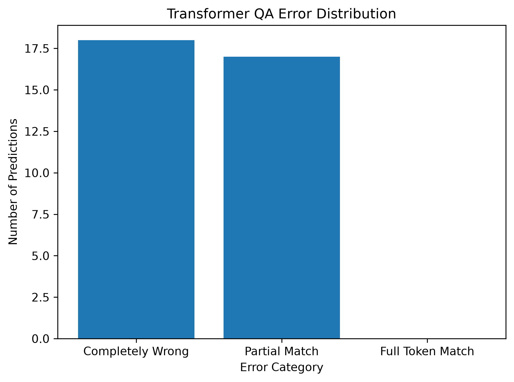

# Transformer-QA: Extractive Question Answering System

An end-to-end **Extractive Question Answering (QA) System** built using pretrained Transformer models, with model evaluation, performance comparison, error analysis, and an interactive Streamlit application.

The system answers natural-language questions by extracting relevant text spans from a user-provided context.

## Project Overview

This project explores how Transformer-based language models perform on extractive question answering tasks.

Three pretrained QA models are evaluated:

- DistilBERT
- BERT-Cased
- RoBERTa

The project uses the Stanford Question Answering Dataset (SQuAD) and evaluates model predictions using Exact Match (EM) and token-level F1 Score.

An interactive Streamlit interface allows users to enter a context, ask questions, and explore model comparison results.

## Key Features

- Context-based extractive question answering
- Pretrained Transformer model inference
- Support for DistilBERT, BERT-Cased, and RoBERTa
- SQuAD dataset loading and preprocessing
- Question and context tokenization
- Exact Match and F1 Score evaluation
- Comparison of three Transformer QA models
- Inference time measurement
- Prediction error analysis
- Error distribution visualization
- Interactive Streamlit web application
- CSV-based evaluation result storage

## Technology Stack

**Programming Language:** Python

**Deep Learning:** PyTorch

**Natural Language Processing:** Hugging Face Transformers

**Dataset Processing:** Hugging Face Datasets, Pandas

**Visualization:** Matplotlib

**Web Application:** Streamlit

**Version Control:** Git and GitHub

## Dataset

**Dataset:** Stanford Question Answering Dataset (SQuAD v1.1)

SQuAD is a reading comprehension dataset containing questions based on Wikipedia passages.

Each example includes:

- Context: A passage containing relevant information
- Question: A natural-language question
- Answers: One or more reference answer spans

Dataset source:
https://rajpurkar.github.io/SQuAD-explorer/

### Evaluation Setup

| Parameter | Value |
|---|---|
| Dataset | SQuAD |
| Split | Validation |
| Evaluation samples | 200 |
| Random seed | 42 |
| Evaluation metrics | Exact Match, F1 Score |
| Task | Extractive Question Answering |

The same shuffled validation sample is used for comparing the three models.

The reported results are based on 200 validation examples rather than the entire SQuAD validation dataset.

## Transformer Models

### 1. DistilBERT

Checkpoint:

`distilbert/distilbert-base-uncased-distilled-squad`

DistilBERT is a compressed version of BERT designed to reduce computational requirements while maintaining strong language understanding performance.

### 2. BERT-Cased

Checkpoint:

`deepset/bert-base-cased-squad2`

BERT is a bidirectional Transformer encoder capable of learning contextual representations of text.

### 3. RoBERTa

Checkpoint:

`deepset/roberta-base-squad2`

RoBERTa is an optimized BERT-based architecture trained using an improved pretraining strategy.

**Important:** These are existing pretrained, task-adapted QA checkpoints. This project does not perform additional model fine-tuning.

The selected checkpoints were not all fine-tuned using identical QA datasets or training procedures. Therefore, the comparison represents the performance of these specific checkpoints, not a fully controlled architectural benchmark.

## System Workflow

```text
User Input
    |
    v
Context + Question
    |
    v
Input Validation
    |
    v
Tokenizer
    |
    v
Transformer QA Model
    |
    v
Start and End Span Prediction
    |
    v
Extracted Answer
    |
    v
Streamlit Interface
```

### Evaluation Workflow

```text
SQuAD Validation Dataset
          |
          v
Shuffle (Seed = 42)
          |
          v
Select 200 Samples
          |
          v
Transformer QA Inference
          |
          v
Predicted Answers
          |
          v
Compare with Reference Answers
          |
          v
Exact Match + F1 Score
          |
          v
CSV Results + Error Analysis
```

## Model Evaluation Results

The following results were obtained using 200 SQuAD validation examples.

| Model | Exact Match (%) | F1 Score (%) |
|---|---:|---:|
| DistilBERT | 82.50 | 87.39 |
| BERT-Cased | 77.50 | 84.93 |
| **RoBERTa** | **85.50** | **89.90** |

### Key Findings

- RoBERTa achieved the highest Exact Match and F1 Score in this evaluation.
- DistilBERT achieved competitive performance despite its smaller architecture.
- BERT-Cased achieved lower scores than the other two selected checkpoints on this evaluation sample.
- Results may vary with different samples, checkpoints, and inference configurations.

These findings apply to the evaluated checkpoints and selected validation examples.

## Evaluation Metrics

### Exact Match (EM)

Exact Match measures whether a predicted answer exactly matches a reference answer after normalization.

```text
EM = 1, if normalized prediction equals normalized reference
EM = 0, otherwise
```

### F1 Score

Token-level F1 measures the overlap between predicted and reference answer tokens.

```text
Precision = Common Tokens / Predicted Tokens

Recall = Common Tokens / Reference Tokens

F1 = 2 * Precision * Recall / (Precision + Recall)
```

For examples with multiple reference answers, the maximum score across the available references is used.

## Error Analysis

Prediction errors were analyzed for the DistilBERT evaluation.

**Total evaluation samples:** 200

**Exact Match:** 82.50%

**Non-exact predictions:** 35

### Error Distribution

| Error Category | Count |
|---|---:|
| Completely Wrong (F1 = 0) | 18 |
| Partial Match (0 < F1 < 1) | 17 |
| Full Token Match (F1 = 1) | 0 |

Additionally, 23 non-exact predictions had an F1 Score below 0.5.

The low-F1 count overlaps with the error categories above and is not an additional mutually exclusive category.

### Error Visualization



The analysis highlights common limitations of extractive QA systems, including incorrect answer span selection and partially correct answers.

## Project Structure

```text
Transformer-QA/
|
|-- app.py
|-- requirements.txt
|-- README.md
|-- .gitignore
|
|-- src/
|   |-- __init__.py
|   |-- data_loader.py
|   |-- dataset_analysis.py
|   |-- preprocessing.py
|   |-- model.py
|   |-- evaluation.py
|   |-- model_comparison.py
|   |-- error_analysis.py
|
|-- results/
|   |-- model_comparison_results.csv
|   |-- wrong_predictions.csv
|   |-- error_distribution.png
```

## Installation and Setup

### 1. Clone the Repository

```bash
git clone https://github.com/YOUR_USERNAME/Transformer-QA.git
cd Transformer-QA
```

Replace `YOUR_USERNAME` with the actual GitHub username after publication.

### 2. Create a Virtual Environment

```bash
python -m venv .venv
```

### 3. Activate the Environment

**Windows PowerShell:**

```powershell
.venv\Scripts\Activate.ps1
```

**Windows Git Bash:**

```bash
source .venv/Scripts/activate
```

**Linux/macOS:**

```bash
source .venv/bin/activate
```

### 4. Install Dependencies

```bash
python -m pip install -r requirements.txt
```

Python 3.12 is the development environment used for this project.

Model checkpoints and dataset files may be downloaded automatically during the first run. An internet connection is required for initial downloads.

## Running the Application

Start the Streamlit application:

```bash
streamlit run app.py
```

The application will open in a browser, usually at:

`http://localhost:8501`

### How to Use

1. Enter or paste a context passage.
2. Enter a question related to the context.
3. Select an available QA model.
4. Run question answering.
5. View the extracted answer.
6. Explore model comparison results.

## Running Evaluation

Evaluate the default QA model:

```bash
python -m src.evaluation
```

The evaluation calculates Exact Match and F1 Score and saves non-exact predictions to:

`results/wrong_predictions.csv`

## Running Model Comparison

Compare the three Transformer checkpoints:

```bash
python -m src.model_comparison
```

Results are saved to:

`results/model_comparison_results.csv`

**Note:** Model comparison can take considerable time on CPU-only systems because all three models must perform inference on the evaluation samples.

## Running Error Analysis

```bash
python -m src.error_analysis
```

This analyzes non-exact predictions and saves the visualization to:

`results/error_distribution.png`

Run the evaluation script first if the wrong predictions CSV does not exist.

## Limitations

- The project uses pretrained QA checkpoints without additional fine-tuning.
- Reported results are based on 200 validation examples.
- The three checkpoints have different original fine-tuning configurations.
- Extractive QA is limited to selecting answers from the supplied context.
- Incorrect or incomplete context can produce incorrect answers.
- CPU inference may be slower than GPU inference.
- A formal no-answer detection benchmark is not included in this release.

## Future Improvements

Potential future enhancements include:

- Fine-tuning on SQuAD
- Improved no-answer detection
- Expanded evaluation on larger datasets
- Additional Transformer model comparisons
- Improved inference efficiency
- More detailed error categorization

## Project Status

**Version:** 1.0

**Status:** Ready for initial release preparation

**Project Type:** NLP / Deep Learning / Transformer-based Question Answering

**Development Context:** AI Engineering Internship Project

## Author

**Md. Shakibul Hasan**

AI & Data Science Student | Aspiring AI Engineer

---

Built to explore practical Transformer-based NLP, extractive question answering, and model evaluation.